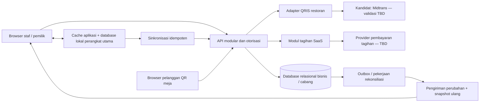

# MejaFlow — Product Requirements Document (PRD)

**Versi:** 2.2 — Draft hasil discovery baru + revisi KDS (D-64, D-65)  
**Tanggal:** 8 November 2026  
**Bahasa:** Indonesia  
**Status:** Keputusan produk telah dikonfirmasi melalui wawancara; usulan teknis dan TBD perlu ditinjau sebelum implementasi.

**Revisi 2.1 (8 November 2026):** KDS tidak menampilkan nilai total maupun komponen biaya pesanan; teks item diperbesar dengan jarak lebih lega; menekan teks/baris item menandai item tersebut Siap. **Dikonfirmasi: D-64.**

**Revisi 2.2 (8 November 2026):** Dine-in dengan KDS dipindahkan ke kolom Siap setelah semua item Siap dan baru selesai setelah staf mengonfirmasi penyajian. **Dikonfirmasi: D-65.**

Dokumen ini ditulis dari nol berdasarkan 65 keputusan terbaru pengguna. PRD lama, blueprint sebelumnya, dan perilaku aplikasi yang sudah ada tidak otomatis menjadi persyaratan versi ini. Dokumen ini menjelaskan produk yang akan dibangun, bukan menyatakan semua fiturnya sudah tersedia.

**Cara membaca:** **Dikonfirmasi** berarti berasal dari jawaban pengguna; **Usulan** berarti rancangan untuk mendukung kebutuhan tersebut; **TBD** berarti belum diputuskan. Penanda D-01 sampai D-65 menghubungkan isi dengan keputusan discovery. Penambahan batas, alur, atau teknologi yang belum dikonfirmasi tidak boleh diperlakukan sebagai keputusan produk final.

1. [Overview](#1-overview)
2. [Requirements](#2-requirements)
3. [Core Features](#3-core-features)
4. [User Flow](#4-user-flow)
5. [Architecture](#5-architecture)
6. [Database Schema](#6-database-schema)
7. [Tech Stack](#7-tech-stack)
8. [Deployment](#8-deployment)

## 1. Overview

### 1.1 Masalah dan tujuan

MejaFlow adalah aplikasi Point of Sale (POS) berbasis web untuk banyak bisnis restoran dan kafe. Setiap bisnis memiliki akun, data, dan pengaturan yang terpisah. Pemilik dapat mengelola beberapa cabang dalam satu langganan, sedangkan setiap cabang memiliki menu, harga, staf, pesanan, dan pencatatan penjualan sendiri. **Dikonfirmasi: D-01, D-05, D-09.**

Masalah yang ingin diselesaikan adalah pencatatan transaksi yang tersebar, ketidakjelasan apakah pesanan sudah lunas, serta informasi pesanan yang terlewat antara kasir dan dapur. Untuk bisnis bercabang, pemilik juga membutuhkan satu tempat untuk melihat penjualan cabang maupun gabungan bisnis. Ketika internet terputus, penerimaan tunai harus tetap berjalan pada perangkat kasir utama yang ditetapkan.

Tujuan versi pertama adalah menyediakan kasir yang sederhana, pembayaran yang tercatat, pemesanan mandiri melalui QR meja pada paket berbayar, dan layar dapur bila cabang memiliki staf dapur. Fitur pendukung dibatasi agar mudah digunakan: tidak ada inventori jumlah, varian berbayar, refund dalam aplikasi, cetak thermal, atau rekonsiliasi sesi kas pada rilis ini.

### 1.2 Pengguna dan akses

| Pengguna | Kebutuhan utama |
|---|---|
| Pemilik bisnis | Mendaftar, memverifikasi email, mengelola bisnis/cabang, paket, staf, dan seluruh operasional; melihat laporan gabungan |
| Manajer cabang | Mengawasi operasional cabang, memasukkan diskon, mengelola staf yang diizinkan, dan mengizinkan pengecualian verifikasi takeaway yang dicatat |
| Kasir | Memasukkan pesanan, menerima pembayaran yang diizinkan, melihat transaksi/struk staf, dan mengonfirmasi penyerahan takeaway |
| Staf dapur | Membuka KDS cabangnya, memulai persiapan, serta menandai kesiapan item |
| Pelayan | Membantu operasional dan penyerahan sesuai izin cabang; rincian izin selain yang sudah disepakati tetap TBD |
| Pelanggan | Memesan melalui kasir; pada paket berbayar dapat memindai QR meja dan membayar QRIS terintegrasi |
| Administrator MejaFlow | Mengatur harga paket berbayar; rincian akses dukungan/admin platform masih perlu dirancang |

Aplikasi diakses melalui browser komputer, tablet, dan ponsel tanpa kewajiban memasang aplikasi. Pendaftaran dilakukan sendiri oleh pemilik, dilanjutkan dengan pembuatan bisnis/cabang dan pengaturan awal. Pemilik masuk memakai email dan kata sandi; email wajib diverifikasi sebelum bisnis mulai digunakan. **Dikonfirmasi: D-02, D-06, D-54, D-59.**

### 1.3 Hasil yang diharapkan

- **Transaksi jelas:** Setiap pesanan memiliki identitas, cabang, produk, catatan, total, metode pembayaran, dan status yang dapat ditelusuri.
- **Dapur menerima pesanan lunas:** Tidak ada pesanan belum dibayar yang menjadi pekerjaan dapur.
- **Tunai tetap dapat diterima saat offline:** Satu perangkat utama mencatat transaksi secara lokal dan mengirimnya ketika koneksi kembali.
- **Cabang tetap terpisah:** Staf bekerja pada cabang yang ditugaskan; pemilik dapat menjalankan operasional semua cabang.
- **Pilihan paket sederhana:** Free permanen dan satu paket berbayar dengan kapasitas lebih besar serta QR meja/QRIS terintegrasi.

Indikator keberhasilan yang diusulkan: keberhasilan registrasi/verifikasi, waktu ke transaksi pertama, transaksi lunas yang tercatat tepat satu kali, ketepatan routing KDS, keberhasilan sinkronisasi offline, dan kecocokan laporan terhadap riwayat. Target angka, periode pengukuran, dan ambang kelulusan **TBD**; bukan SLA yang sudah dijanjikan.

## 2. Requirements

### 2.1 Kemudahan penggunaan dan integritas

- **Antarmuka sederhana:** Tampilkan pilihan cabang, daftar produk, keranjang, rincian biaya, metode pembayaran, dan aksi berikutnya secara jelas. Fokus desain versi pertama adalah fungsi; tema, warna, dan komponen visual spesifik **TBD**. Emerald tidak ditetapkan sebagai desain wajib. **D-61.**
- **Pemisahan bisnis dan cabang:** Semua akses data dan tindakan harus diperiksa di server berdasarkan bisnis, cabang, akun, peran, dan hak paket. Batas ini berlaku juga pada data yang disimpan di perangkat offline. **D-01, D-47.**
- **Lunas sebelum diproses:** Pesanan kasir maupun QR meja harus lunas sebelum menjadi pekerjaan dapur. Tunai dan digital manual dikonfirmasi kasir yang berwenang; QRIS terintegrasi memerlukan bukti provider yang diverifikasi server. **D-15, D-17.**
- **Satu metode pembayaran:** Satu pesanan dibayar penuh dengan satu metode. Pembayaran sebagian atau gabungan tunai/QRIS tidak tersedia. **D-29.**
- **Tidak ada draft keranjang:** Keranjang langsung dibayar atau dibuang. Percobaan QRIS yang telah dimulai tetap disimpan untuk pemulihan status; catatan pending pembayaran bukan draft umum yang dapat diedit bebas. **D-30.**
- **Riwayat konsisten:** Pengulangan klik, callback, pengiriman sinkronisasi, atau pekerjaan latar tidak boleh menggandakan transaksi, pembayaran, ataupun tiket dapur. Ini kebutuhan integritas turunan, bukan penambahan fitur komersial.

### 2.2 Paket dan batas penggunaan

**Dikonfirmasi: D-07, D-08, D-09, D-10, D-11, D-12, D-13, D-14, D-16, D-18, D-51, D-52.** Pilihan awal dua paket berbayar sudah diganti menjadi satu paket berbayar. Nama komersialnya **TBD**; dokumen memakai label “Berbayar”.

| Kemampuan/batas | Free | Berbayar |
|---|---|---|
| Masa berlaku | Permanen | Sesuai masa berbayar; tersedia trial |
| Jumlah cabang per bisnis | Maksimal 1 | Maksimal 5 |
| Akun staf, di luar pemilik | Maksimal 1 pada bisnis/cabang tersebut | Maksimal 10 per cabang |
| Transaksi melalui kasir | Ya | Ya |
| Dine-in dan takeaway | Ya | Ya |
| Pengelolaan meja dasar | Ya | Ya |
| Tunai | Ya | Ya |
| Digital manual dikonfirmasi kasir | Ya, hanya transaksi kasir | Tidak |
| QRIS terintegrasi | Tidak | Ya, setelah aktivasi provider yang sah |
| Pelanggan memesan sendiri melalui QR meja | Tidak | Ya; pembayaran wajib QRIS terintegrasi |
| KDS | Ya, per cabang bila memiliki staf dapur terdaftar | Ya, dengan syarat yang sama |

Kebutuhan umum lain yang dikonfirmasi—menu, catatan item, pengaturan biaya, diskon sesuai peran, struk staf, dan laporan dasar—ditulis sebagai kebutuhan versi pertama. Tidak ada pembeda paket tambahan yang disepakati untuk fitur tersebut. Batas jumlah produk, volume transaksi, perangkat online, penyimpanan, atau retensi **belum ditetapkan**; jangan mengasumsikan kuota tertentu atau menjanjikan tanpa batas.

Pemilik berada di luar batas jumlah staf. Rincian apakah akun nonaktif tetap dihitung serta aturan mengganti staf di batas kapasitas **TBD**. Untuk KDS, keberadaan staf dapur ditentukan per cabang; bukan satu akun dapur yang mengaktifkan semua cabang bisnis.

### 2.3 Trial dan siklus langganan

**Dikonfirmasi: D-53, D-54, D-55, D-56, D-62.**

- **Trial:** Berlangsung 30 hari sejak pemilik mengaktifkannya, satu kali per bisnis. Bukan otomatis dimulai saat pendaftaran. Tidak memerlukan metode pembayaran dan tidak memicu autodebit. Email pemilik tetap wajib diverifikasi.
- **Cakupan trial:** Usulan untuk ditinjau adalah memakai kapasitas dan fitur paket Berbayar selama trial; aktivasi QRIS tetap bergantung pada provider. Detail hak trial dan kaitannya dengan keterlambatan aktivasi merchant **TBD**, karena belum ditentukan terpisah.
- **Periode berbayar:** Tersedia bulanan dan tahunan. Administrator MejaFlow mengatur harga masing-masing. Nominal awal, definisi batas tanggal bulanan/tahunan, serta kebijakan perubahan harga dan proration **TBD**.
- **Pembayaran langganan:** Pemilik membayar tagihan melalui penyedia pembayaran. Paket aktif setelah pembayaran diverifikasi otomatis. Tidak ada autodebit. Penyedia tagihan SaaS belum dipilih dan tidak otomatis sama dengan QRIS restoran.
- **Kembali ke Free:** Jika trial atau langganan berakhir tanpa pembayaran lanjutan, pemilik memilih satu cabang dan satu staf yang tetap aktif. Data lainnya tersimpan tetapi tidak dapat dioperasikan. Tidak ada keputusan baru yang mengadopsi grace tujuh hari atau read-only permanen dari PRD lama.
- **Transisi belum lengkap:** Perilaku sebelum pemilik memilih cabang/staf, penanganan pesanan/QRIS pending, hak baca data cabang nonaktif, lama retensi, dan cara mengaktifkan ulang cabang/staf **TBD**. Tidak boleh otomatis menghapus data atau mengubah transaksi lunas.

### 2.4 Peran dan kewenangan

**Dikonfirmasi: D-46, D-47, D-48, D-49, D-50.** Peran manajer, kasir, staf dapur, dan pelayan tersedia, tetapi bisnis tidak wajib mengisi semuanya. Setiap akun staf hanya memiliki satu peran dan satu cabang. Pemilik dapat menjalankan seluruh tugas operasional di semua cabang tanpa membuat akun staf tambahan; akses itu tidak menghilangkan syarat staf dapur untuk aktivasi KDS.

| Tindakan | Aturan yang sudah dikonfirmasi |
|---|---|
| Mengelola staf semua cabang | Pemilik |
| Menambah/mengubah/menonaktifkan staf cabang | Manajer boleh untuk cabangnya, kecuali akun pemilik/manajer lain |
| Memasukkan diskon sebelum pembayaran | Hanya pemilik atau manajer |
| Memulai persiapan/menandai siap | Staf dapur pada KDS cabangnya; pemilik dapat menjalankan operasional |
| Konfirmasi penyerahan takeaway | Kasir/staf sesuai izin; izin detail pelayan/manajer perlu dimatangkan |
| Konfirmasi pesanan dine-in sudah disajikan | Staf di cabang (kasir, pelayan, manajer, pemilik); aksi dicatat sebagai actor |
| Mengizinkan pickup ketika nomor hilang | Manajer setelah pemeriksaan alternatif yang dicatat |
| Prioritas KDS manual | Tidak tersedia untuk siapa pun |
| Pembatalan/replacement/refund pesanan lunas | Tidak tersedia melalui aplikasi versi pertama |

Rincian izin mengubah menu/harga/biaya, melihat laporan/struk bagi tiap peran, kewenangan manajer atas staf dapur terakhir, persetujuan menggunakan akun pemilik, dan cara autentikasi staf **TBD**. Jangan menyimpulkan semua staf memiliki semua izin hanya karena berada pada cabang yang sama. Pemilik/manajer yang memasukkan diskon harus dikenali sebagai actor tersebut, bukan memakai identitas kasir tanpa audit.

### 2.5 Perhitungan harga dan pembulatan

**Dikonfirmasi: D-36, D-37, D-38, D-39, D-40, D-41.**

1. Hitung subtotal dari harga dan jumlah produk yang dipilih.
2. Kurangi diskon manual seluruh pesanan, bila dimasukkan pemilik/manajer. Diskon berupa nominal atau persentase; tidak ada voucher/promo otomatis.
3. Hitung pajak dan biaya layanan masing-masing atas subtotal setelah diskon, sesuai pengaturan persentase dan penerapan dine-in/takeaway cabang.
4. Jumlahkan subtotal setelah diskon, pajak, dan biaya layanan.
5. Bulatkan **total akhir**, sesuai metode pembayaran.

```text
subtotal = jumlah(harga_produk × jumlah)
dasar = subtotal − diskon_pesanan
pajak = dasar × tarif_pajak_yang_berlaku
biaya_layanan = dasar × tarif_layanan_yang_berlaku
total_sebelum_pembulatan = dasar + pajak + biaya_layanan

QRIS / digital manual: total akhir ke rupiah terdekat
Tunai: total akhir ke kelipatan Rp1.000 terdekat
selisih_pembulatan = total_akhir − total_sebelum_pembulatan
```

Pajak tidak dikenakan atas biaya layanan. Biaya yang tidak diaktifkan atau tidak berlaku untuk tipe pesanan tidak ditambahkan. Pemilihan metode dapat mengubah total akhir karena satuan pembulatannya berbeda; total yang benar harus terlihat sebelum pembayaran dikonfirmasi.

**Contoh tanpa pecahan tepat di tengah:** Subtotal Rp23.400, diskon Rp1.000, pajak 10%, dan layanan 5% menghasilkan dasar Rp22.400, pajak Rp2.240, layanan Rp1.120, dan total Rp25.760. QRIS/digital manual tetap Rp25.760; tunai menjadi Rp26.000, dengan penyesuaian pembulatan +Rp240. Angka tarif adalah ilustrasi, bukan tarif pajak yang ditetapkan MejaFlow atau nasihat kewajiban pajak.

**TBD:** Aturan tepat di titik tengah (misalnya Rp25.500 untuk tunai), presisi internal diskon/pajak/layanan, batas tarif, diskon melebihi subtotal, pesanan bernilai nol, dan validasi input. Tidak ada pembulatan per komponen yang telah disetujui. Usulan implementasi memakai aritmetika desimal/fixed precision dan menyimpan komponen serta selisih pembulatan agar total dapat direkonsiliasi.

### 2.6 Offline dan batas keandalan

**Dikonfirmasi: D-03, D-04, D-58.**

- **Satu perangkat utama per lokasi:** Hanya perangkat kasir utama menerima tunai saat offline. Perangkat lain menunggu koneksi kembali. Penetapan perangkat dan perpindahan peran perangkat memerlukan desain yang dapat diuji.
- **Tunai saja:** QRIS terintegrasi dan digital manual memerlukan internet. Offline tidak boleh mengubah status digital pending menjadi lunas atau mengizinkan pencatatan digital manual.
- **Langsung selesai:** Pesanan tunai baru saat offline langsung selesai tanpa tracking, walaupun cabang biasanya memakai KDS. Ketika tersinkron, transaksi tidak boleh memunculkan tiket dapur baru.
- **Simpan dahulu:** Aplikasi hanya menampilkan transaksi offline berhasil setelah catatannya tersimpan secara lokal. Jika penyimpanan gagal, jangan menampilkan keberhasilan palsu.
- **Terlihat jelas:** Perangkat menampilkan mode offline, waktu data terakhir diperbarui, jumlah transaksi belum tersinkron, serta hasil/gagal sinkronisasi. Laporan cloud belum mencakup transaksi yang masih lokal.

Mode offline di browser memerlukan kesiapan sebelumnya: aplikasi dan data yang diperlukan harus sudah tersedia pada perangkat serta ada autentikasi/hak offline yang sah. Detail itu adalah **usulan teknis**, bukan janji pendaftaran atau pemulihan kata sandi dapat berjalan tanpa internet. Batas lama offline, versi browser/perangkat yang didukung, masa berlaku hak, dan pemulihan ketika perangkat rusak **TBD**.

### 2.7 Persyaratan kualitas turunan

| Area | Kebutuhan | Target atau rincian terbuka |
|---|---|---|
| Isolasi | Tolak akses lintas bisnis/cabang tanpa izin pada API, event, laporan dan cache lokal | Matriks uji dua bisnis dan beberapa cabang wajib disiapkan |
| Pembayaran | Verifikasi bukti provider, nominal, currency, referensi, merchant dan status sesuai kontrak | Detail provider TBD; tidak percaya redirect atau screenshot sebagai sukses QRIS otomatis |
| Konsistensi | Satu efek finansial dan satu efek routing untuk satu transaksi yang sah | Uji klik ganda, webhook ulang dan retry sinkronisasi |
| Realtime | KDS mencerminkan status server dan pulih setelah koneksi kembali | Target latensi dan mekanisme transport usulan |
| Keamanan | Hash kata sandi, autentikasi/otorisasi server, secret backend, rate limiting dan audit | Kebijakan sesi, password reset, MFA, dan offline credential TBD |
| Privasi | Proses data pelanggan seperlunya; akses receipt/history tidak publik secara tidak sengaja | Akun pelanggan, retensi, kebijakan akses dan legal review TBD |
| Pemulihan | Backup server, restore drill, serta pemantauan transaksi lokal belum terkirim | RPO/RTO, jadwal, retention dan penanggung jawab TBD |
| Aksesibilitas | Teks terbaca, label status, fokus/keyboard dan ukuran kontrol sentuh yang layak | Standar/target final dan matriks perangkat TBD |

Tidak ada angka uptime, throughput, performa, retensi, atau kuota provider yang dianggap sudah disetujui.

### 2.8 Register keputusan yang masih terbuka

Register ini membatasi hal yang belum disepakati tanpa memperpanjang discovery untuk setiap pilihan implementasi.

| ID | Hal yang perlu diputuskan/divalidasi | Sebelum |
|---|---|---|
| TBD-01 | Nama/harga awal paket berbayar, versi harga, proration, awal/akhir periode | Penjualan paket berbayar |
| TBD-02 | Hak fitur trial dan dampak onboarding merchant pada trial; aktivasi oleh pemilik sudah dikonfirmasi | Peluncuran trial |
| TBD-03 | Penyedia/metode tagihan SaaS, masa aktif invoice dan bukti pembayaran | Penagihan nyata |
| TBD-04 | Downgrade sebelum pilihan cabang/staf, transaksi berjalan, kanal QRIS dan reaktivasi | Trial/langganan dapat berakhir |
| TBD-05 | Kontrak Midtrans, penerima settlement, cakupan merchant/cabang, biaya dan bukti aktivasi | QRIS nyata |
| TBD-06 | Expiry/retry/fallback QRIS, late success dan penyelesaian sengketa di luar aplikasi | QRIS nyata |
| TBD-07 | Jenis pembayaran digital manual Free dan referensi pencatatannya; konfirmasi oleh kasir sudah dikonfirmasi | Checkout Free produksi |
| TBD-08 | Presisi uang, titik tengah pembulatan, tarif/diskon invalid, nilai nol dan uang diterima/kembalian | Perhitungan produksi |
| TBD-09 | Penetapan/penggantian perangkat utama, masa offline, kuota lokal dan credential offline | Offline produksi |
| TBD-10 | Sinkronisasi lintas versi, perubahan paket/izin saat offline dan pemulihan perangkat | Offline produksi |
| TBD-11 | Sinkronisasi kondisi cabang/KDS dan QR meja ketika internet cabang terputus | QR meja produksi |
| TBD-12 | Saat meja mulai terisi, QR yang digunakan ulang, abandoned/pending checkout dan perpindahan meja | Meja/QR meja produksi |
| TBD-13 | Penghapusan/penonaktifan staf dapur terakhir, KDS sedang berjalan dan definisi staf terdaftar yang memenuhi syarat | Pengelolaan staf produksi |
| TBD-14 | Izin lengkap tiap peran, pembuatan/login/reset akun staf, akun nonaktif dan hitungan kuota | Manajemen staf produksi |
| TBD-15 | Verifikasi alternatif pickup, audit/reauth manajer dan cakupan hak pemilik | Handover produksi |
| TBD-16 | Definisi total penjualan, cutoff tanggal/timezone, filter, akses riwayat dan cabang nonaktif | Laporan produksi |
| TBD-17 | Akses pelanggan QR ke status/konfirmasi pesanan, identitas/nama, dan batas struk staf | QR meja produksi |
| TBD-18 | Produk tidak tersedia setelah dibayar, kesalahan tunai dan refund eksternal tanpa fitur refund aplikasi | Transaksi produksi |
| TBD-19 | Desain visual, aksesibilitas, isi profil/receipt dan format nomor pesanan | Desain penerimaan |
| TBD-20 | Stack final, hosting/residency, kapasitas, auth/email, backup dan target operasional | Pemilihan implementasi |
| TBD-21 | Versi browser/OS/perangkat serta kelayakan offline dalam browser tanpa instalasi | Pilot |
| TBD-22 | Retensi, arsip/penghapusan data, penanganan akun dan kewajiban legal | Peluncuran |
| TBD-23 | Scope, paket, biaya, kuota, provider dan kualitas AI | Rilis fitur AI kemudian |

### 2.9 Kriteria penerimaan minimum

Kriteria berikut memverifikasi keputusan produk. Kriteria yang bergantung pada TBD dilengkapi setelah keputusan terkait ditutup.

| ID | Skenario | Hasil yang harus terlihat |
|---|---|---|
| AC-01 | Registrasi dan verifikasi | Pemilik mendaftar dengan email/sandi; bisnis belum dapat digunakan sebelum email terverifikasi |
| AC-02 | Isolasi tenant | Akun bisnis A tidak bisa membaca/mengubah menu, pesanan, laporan atau cache bisnis B |
| AC-03 | Cabang Free | Cabang kedua tidak dapat dioperasikan pada paket Free |
| AC-04 | Cabang Berbayar | Bisnis dapat mengelola hingga 5 cabang; cabang keenam melampaui batas |
| AC-05 | Staf Free | 1 staf di luar pemilik diperbolehkan; penambahan melewati batas ditolak menurut kebijakan akun aktif final |
| AC-06 | Staf Berbayar | Setiap cabang dibatasi 10 staf di luar pemilik; kuota bukan hanya 10 untuk seluruh bisnis |
| AC-07 | Cabang dan peran staf | Akun staf mempunyai satu peran dan satu cabang; tidak memperoleh akses cabang lain |
| AC-08 | Pemilik/manajer | Pemilik beroperasi semua cabang; manajer tidak dapat mengelola pemilik/manajer lain |
| AC-09 | Trial | Diaktifkan pemilik selama 30 hari sekali per bisnis; tidak meminta kartu/mandat autodebit |
| AC-10 | Tagihan SaaS | Pembayaran invoice yang sah mengaktifkan paket satu kali; callback ulang tidak memperpanjang dua kali |
| AC-11 | Downgrade | Cabang/staf terpilih tetap operasional sesuai Free; data lain tidak dihapus; transisi unresolved mengikuti keputusan TBD-04 |
| AC-12 | Pembayaran Free | Kasir dapat mengonfirmasi tunai/digital manual; tidak ada checkout QRIS terintegrasi atau self-order QR meja |
| AC-13 | Pembayaran Berbayar | Kasir hanya dapat memakai tunai atau QRIS; tidak ada digital manual |
| AC-14 | QR meja | Pelanggan harus memakai QRIS terintegrasi; pending/unpaid tidak menjadi tiket dapur |
| AC-15 | Bukti QRIS | Redirect/browser atau webhook palsu tidak melunasi pesanan; callback sah yang berulang hanya berefek sekali |
| AC-16 | Pembayaran tunggal | Tidak dapat mencampur tunai/QRIS atau membayar sebagian satu pesanan |
| AC-17 | Keranjang/pending | Keranjang tidak disimpan sebagai draft; percobaan QRIS tetap pulih setelah refresh |
| AC-18 | Katalog cabang | Perubahan harga/status cabang A tidak mengubah katalog cabang B atau snapshot transaksi lama |
| AC-19 | Produk sederhana | Pilihan berbeda adalah produk terpisah; tidak ada editor varian/topping berbayar |
| AC-20 | Catatan item | Catatan dari kasir/QR meja tampil pada item KDS dan tidak menambah harga |
| AC-21 | Diskon | Kasir biasa tidak dapat memasukkan diskon; manajer/pemilik dapat sebelum pembayaran |
| AC-22 | Biaya | Pajak dan layanan memakai dasar setelah diskon dan penerapan tipe pesanan yang benar |
| AC-23 | Pembulatan | Contoh Rp25.760 menjadi Rp26.000 untuk tunai dan Rp25.760 untuk QRIS/digital manual |
| AC-24 | KDS per cabang | Keberadaan staf dapur cabang A tidak mengaktifkan KDS cabang B |
| AC-25 | KDS manual start | Tiket Baru tetap Baru sampai Mulai Persiapan ditekan; tidak otomatis Preparing |
| AC-26 | Kesiapan item | Satu item belum siap membuat pesanan belum Siap; Tandai Semua Siap memperbarui semua item yang berlaku |
| AC-27 | FIFO | Antrean mengikuti urutan pembayaran lunas tanpa kontrol prioritas manual |
| AC-28 | Dine-in KDS | Semua item Siap memindahkan tiket ke kolom Siap; pesanan selesai setelah staf mengonfirmasi sudah disajikan |
| AC-29 | Takeaway KDS | Semua item Siap belum menyelesaikan takeaway sampai penyerahan dikonfirmasi |
| AC-30 | Pickup | Nomor cocok memungkinkan penyerahan; nomor hilang memerlukan pemeriksaan alternatif dan izin manajer tercatat |
| AC-31 | Tanpa dapur | Pesanan langsung Selesai setelah lunas, tanpa tracking atau tiket KDS |
| AC-32 | Pesanan semeja | Pembelian tambahan memiliki nomor/pembayaran baru; tabel baru bebas jika semua pesanan terkait selesai |
| AC-33 | Tidak ada koreksi lunas | Tidak tersedia tombol/API normal pembatalan, replacement atau refund pesanan lunas |
| AC-34 | Offline device | Hanya perangkat utama cabang dapat membuat transaksi offline; perangkat lain menunggu |
| AC-35 | Offline tunai | Hanya tunai; transaksi tersimpan lokal dan Selesai tanpa tracking |
| AC-36 | Offline refresh/retry | Reload dan pengiriman ulang tidak kehilangan atau menggandakan transaksi yang sudah tersimpan |
| AC-37 | Sinkronisasi | Transaksi offline masuk riwayat/laporan tepat satu kali dan tidak membuat tiket KDS |
| AC-38 | Penyimpanan gagal | Kehabisan kuota/write failure tidak ditampilkan sebagai transaksi lokal berhasil |
| AC-39 | Struk | Struk digital tersedia bagi staf sesuai izin; tidak ada share pelanggan, PDF pelanggan atau thermal printing |
| AC-40 | Laporan | Total penjualan cocok dengan definisi yang disetujui dan riwayat; tidak ada modul shift/selisih kas |
| AC-41 | KDS tanpa nilai uang | Tiket KDS tidak menampilkan total/biaya pesanan; teks item lebih besar dan menekan teks/baris item menandainya Siap |
| AC-42 | Konfirmasi disajikan | Dine-in tetap di kolom Siap sampai staf mengonfirmasi penyajian; setelah konfirmasi pesanan selesai dan meja dilepas bila tidak ada pesanan aktif lain |

## 3. Core Features

### 3.1 Workspace bisnis dan cabang

Pemilik membuat bisnis dan cabang sesuai batas paket. Pemilik dapat berpindah cabang untuk menjalankan operasional atau melihat laporan gabungan. Identitas cabang aktif harus jelas pada kasir, menu, pesanan dan laporan agar transaksi tidak salah lokasi.

Setiap cabang memiliki katalog, harga, ketersediaan dan pengaturan pajak/layanan sendiri. Tidak ada keputusan yang mewajibkan katalog terpusat, penyalinan otomatis, atau berbagi stok antarcabang. **D-33.**

### 3.2 Menu dan ketersediaan

Produk dijual dengan satu harga. Jika ada pilihan ukuran/rasa/harga berbeda, masing-masing dibuat sebagai produk tersendiri. Versi pertama tidak memiliki varian/modifier berbayar. Status produk hanya **Tersedia** atau **Habis**, diubah manual; tidak ada jumlah stok, pengurangan otomatis, bahan baku atau resep. **D-32, D-34.**

Kasir dan pelanggan QR meja dapat memberi catatan per item tanpa perubahan harga. KDS menampilkan produk, jumlah dan catatan yang sama. Pemisahan baris catatan untuk produk sama merupakan kebutuhan tampilan turunan; format akhirnya mengikuti desain. **D-35.**

### 3.3 POS kasir

Kasir memilih dine-in/takeaway, produk, jumlah, catatan dan metode pembayaran yang tersedia pada paket. Diskon seluruh pesanan hanya dapat dimasukkan pemilik/manajer sebelum pembayaran. Total menampilkan subtotal, diskon, pajak, biaya layanan, penyesuaian pembulatan dan jumlah akhir.

Konfirmasi lunas menghasilkan transaksi/struk staf dan menjalankan aturan KDS atau penyelesaian langsung. Fitur memasukkan uang diterima/kembalian tunai belum disepakati detailnya dan tetap TBD; dokumen tidak menambah fitur sesi laci kas.

### 3.4 QR meja dan QRIS

Pada paket Berbayar, pelanggan membuka link QR meja cabang, memilih produk dan catatan, lalu membayar menggunakan QRIS terintegrasi. QR link meja adalah akses menu/pemesanan; kode QRIS adalah instruksi pembayaran untuk percobaan transaksi tertentu. Keduanya tidak disamakan.

Midtrans dipilih sebagai **kandidat**, bukan integrasi yang telah dijamin tersedia. QRIS nyata memerlukan bukti aktivasi merchant/kanal dan kontrak teknis yang sah. Kelayakan bisnis/cabang dan settlement harus diverifikasi; tidak ada model fee 1% atau pooling dana yang dibawa otomatis dari pembahasan lama. **D-57.**

Gerbang merchant ditujukan untuk QRIS; PRD baru tidak menetapkan verifikasi Midtrans sebagai syarat menjalankan meja atau transaksi tunai. Kebijakan saat QRIS belum aktif harus menjelaskan fitur yang belum dapat dipakai tanpa menjanjikan QR self-order sudah berjalan.

### 3.5 KDS dan penyelesaian

**Dikonfirmasi: D-18, D-19, D-20, D-21, D-22, D-23, D-24, D-25, D-26.**

| Kondisi | Setelah lunas | Langkah berikutnya | Kapan selesai |
|---|---|---|---|
| Online, cabang memiliki staf dapur, dine-in | Tiket Baru | Mulai Persiapan → kesiapan item → kolom Siap | Setelah staf mengonfirmasi sudah disajikan |
| Online, cabang memiliki staf dapur, takeaway | Tiket Baru | Mulai Persiapan → semua item Siap → tunggu penyerahan | Kasir/staf mengonfirmasi penyerahan |
| Online, cabang tanpa staf dapur | Selesai | Tidak ada tracking | Saat pembayaran penuh dikonfirmasi |
| Offline, tunai pada perangkat utama | Selesai lokal | Sinkronkan riwayat saat online; tidak dispatch | Saat pembayaran dicatat dan tersimpan lokal |

**Dikonfirmasi: D-64.** KDS tidak menampilkan nilai total maupun komponen biaya pesanan. Tiket hanya memuat nomor pesanan, tipe/meja, waktu, nama produk, jumlah, dan catatan item. Identitas meja (atau “Takeaway” bila tanpa meja) ditampilkan sebagai judul tiket yang besar dan tebal, sedangkan nomor pesanan dan waktu menjadi metadata sekunder. Teks item diperbesar dan jarak antarbaris ditambah agar terbaca dari area dapur; menekan teks item (seluruh baris item) menandai item tersebut Siap, setara dengan kontrol per item sebelumnya. **Tandai Semua Siap** tetap tersedia.

**Dikonfirmasi: D-65.** Pesanan dine-in yang seluruh itemnya Siap dipindahkan ke kolom Siap, bukan langsung Selesai. Staf mengonfirmasi apakah pesanan sudah disajikan; setelah konfirmasi, pesanan Selesai dan meja dapat dilepas. Takeaway tetap memakai konfirmasi penyerahan.

Antrean KDS berdasarkan urutan pembayaran lunas, tanpa prioritas manual. Item ditandai siap satu per satu dengan menekan baris item, atau melalui **Tandai Semua Siap**. Teknologi dapat menyimpan timestamp/urutan server untuk mengurutkan pembayaran bersamaan; kebijakan tie-break teknis belum final.

Takeaway yang menunggu penyerahan membutuhkan nomor pesanan yang cocok. Bila nomor hilang, manajer dapat mengizinkan setelah pemeriksaan alternatif yang dicatat. Bukan aturan “tanpa override” dari dokumen lama. Proses handover yang diulang tidak boleh menandai selesai dua kali.

### 3.6 Meja dan pesanan tambahan

Meja otomatis Tersedia setelah seluruh pesanan terkait selesai. Pada cabang tanpa KDS, transaksi selesai ketika dibayar; pada cabang dengan KDS, dine-in selesai setelah semua item Siap dan staf mengonfirmasi penyajian. Konfirmasi berasal dari staf, bukan sensor okupansi fisik; status Tersedia tetap tidak menjamin pelanggan sudah meninggalkan tempat duduk. Ini konsekuensi yang sudah dijelaskan dan dipilih pengguna. **D-27, D-65.**

Tambahan pembelian pada meja yang sama menjadi pesanan baru dengan nomor dan pembayaran sendiri. Tidak ada tagihan meja bersama yang terus ditambah setelah lunas. **D-28.** Pembuatan/penempatan meja, saat awal Occupied, pending pembayaran, dan perpindahan meja perlu diselesaikan pada TBD-12; jangan menerapkan ulang workflow lama tanpa review.

### 3.7 Struk dan laporan

Struk digital hanya dilihat staf dalam aplikasi sesuai izin. Tidak ada pembagian struk ke pelanggan, QR receipt pelanggan, PDF pelanggan, pengiriman WhatsApp/email, atau thermal printing pada versi pertama. Konfirmasi/progres pemesanan QR pelanggan, bila diperlukan, harus dirancang terpisah dari fitur struk staf. **D-42, D-43.**

Laporan hanya mencakup **total penjualan dan daftar riwayat transaksi**, per cabang dan gabungan sesuai hak akses. Tidak ada dashboard produk terlaris, analitik kompleks, cash-session opening/closing, hitungan kas fisik atau selisih kas. Filter, definisi penjualan termasuk/tidak termasuk pajak/layanan, zona waktu dan cutoff tetap TBD. **D-44, D-45.**

### 3.8 Di luar versi pertama

- Pembatalan, penggantian dan refund pesanan lunas melalui aplikasi. Penanganan eksternal tetap perlu prosedur sebelum menerima uang nyata; fitur tersebut tidak ditambahkan diam-diam. **D-31.**
- Inventori jumlah, bahan baku, resep/HPP, purchasing dan stok otomatis.
- Varian/modifier berbayar, voucher, promo otomatis, loyalty dan CRM.
- Split/mixed payments, draft keranjang tersimpan, dan prioritas KDS manual.
- Thermal printing, pengiriman struk pelanggan, sesi kas dan rekonsiliasi laci.
- Aplikasi native atau kewajiban instalasi PWA; offline browser tetap memerlukan validasi kompatibilitas.

### 3.9 Fitur lanjutan: AI menu cetak

AI pembaca foto menu merupakan fitur lanjutan setelah versi pertama. Hasil ekstraksi harus ditinjau pengguna sebelum diterbitkan. Tidak ada auto-publish atau perubahan harga tersembunyi. **D-60.**

Usulan alur berikutnya: unggah foto → hasil draft → cocokkan dengan gambar → koreksi nama/harga → tinjau duplikasi → konfirmasi publish. Dukungan multi-foto, varian, provider/model, kuota, biaya, paket, retensi gambar, kontrol kualitas dan skema draft bukan persyaratan final rilis pertama dan tercatat TBD-23.

## 4. User Flow

### 4.1 Pendaftaran, aktivasi bisnis dan trial

1. Pemilik membuat akun email/kata sandi dan menyelesaikan verifikasi email.
2. Pemilik membuat bisnis, cabang awal dan pengaturan yang diperlukan.
3. Free digunakan sesuai batas 1 cabang/1 staf. Alur pemilihan paket awal dalam formulir registrasi merupakan detail desain; jangan memulai trial otomatis.
4. Pemilik dapat mengaktifkan trial berbayar satu kali per bisnis. Sistem mencatat waktu mulai dan akhir 30 hari tanpa meminta metode pembayaran.
5. Aktivasi QRIS dilakukan lewat mekanisme provider yang tervalidasi. Trial atau paket berbayar tidak menjadi bukti merchant siap menerima QRIS.
6. Pemilik menambah cabang/staf sesuai kapasitas yang berlaku. Data/menu/harga disiapkan untuk masing-masing cabang.

### 4.2 Transaksi kasir ketika online

1. Kasir atau pemilik membuka cabang yang berhak diakses dan memilih dine-in atau takeaway.
2. Pilih produk yang Tersedia, jumlah dan catatan per item. Untuk dine-in, kaitkan meja sesuai rancangan dasar meja.
3. Jika diperlukan, pemilik/manajer memasukkan diskon. Sistem menghitung biaya dan total sesuai metode yang akan dipakai.
4. Free menawarkan tunai atau digital manual. Berbayar menawarkan tunai atau QRIS terintegrasi.
5. Pada tunai/digital manual, kasir mengonfirmasi penerimaan penuh. Pada QRIS, server menunggu pembayaran terverifikasi.
6. Setelah lunas, catat transaksi dan struk staf. Bila ada staf dapur terdaftar pada cabang, buat satu pekerjaan KDS; bila tidak, tandai Selesai tanpa tracking.
7. Dine-in/takeaway dengan KDS mengikuti alur di bawah. Kasir dapat membuka riwayat/struk menurut hak aksesnya.

**Batas:** Mengganti metode sebelum membayar dapat mengubah total pembulatan. Ketika QRIS sudah dimulai, kasir tidak boleh begitu saja menimpa nilai atau mengonfirmasi tunai tanpa penyelesaian aman percobaan sebelumnya. Aturan provider untuk retry/fallback dan expiry tetap TBD-06.

### 4.3 Pemesanan mandiri QR meja

1. Pelanggan memindai QR meja dan membuka browser yang mengidentifikasi bisnis, cabang dan meja.
2. Sistem memeriksa paket, cabang yang operasional, serta kesiapan kanal QRIS.
3. Pelanggan memilih produk Tersedia, jumlah dan catatan; tidak tersedia tambahan berbayar atau diskon yang diisi pelanggan.
4. Sistem menyajikan subtotal dan biaya yang berlaku, lalu membuat percobaan QRIS untuk total final dalam rupiah.
5. Selama Pending, pesanan belum masuk dapur. Menutup browser tidak menghapus referensi percobaan.
6. Server memverifikasi hasil provider. Jika lunas, jalankan routing sesuai KDS cabang, tepat satu kali.
7. Pesanan tambahan di meja yang sama memulai nomor/pembayaran baru.

**TBD:** Identitas pelanggan, akses untuk membuka kembali status pesanan, informasi konfirmasi yang diperlihatkan, dan hubungan dengan struk staf. Tidak diwajibkan akun pelanggan atau pengiriman email/WhatsApp hanya karena tersedia QR meja. Untuk cabang tanpa staf dapur, keputusan saat ini tetap menyelesaikan transaksi segera setelah lunas.

### 4.4 Dapur dan handover

**Dine-in dengan KDS:** Lunas → Baru → staf dapur menekan Mulai Persiapan → Sedang Disiapkan → item Siap satu per satu (menekan baris item)/semua → seluruh item Siap → kolom Siap → staf mengonfirmasi sudah disajikan → Selesai.

**Takeaway dengan KDS:** Lunas → Baru → Mulai Persiapan → seluruh item Siap → tunggu penyerahan → staf mencocokkan nomor pesanan → konfirmasi diserahkan → Selesai.

Jika nomor takeaway hilang, staf tidak langsung melewati pemeriksaan: manajer memeriksa bukti alternatif, mengizinkan penyerahan dan mencatatnya. Jenis pemeriksaan serta cara autentikasi persetujuan diselesaikan pada TBD-15. Aplikasi tidak menambah approval refund, replacement atau prioritas pesanan melalui jalur izin pickup.

### 4.5 Transaksi tunai offline

1. Sebelumnya, perangkat utama sudah disiapkan ketika online: identitas/cabang, data operasional dan hak offline tersedia sesuai desain yang disetujui.
2. Saat koneksi terputus, perangkat utama menampilkan mode Offline. Perangkat lain tidak menerima transaksi offline.
3. Kasir memakai data lokal yang tersedia, memilih produk/catatan dan menerima tunai. QRIS dan digital manual tidak ditawarkan.
4. Perhitungan mengikuti snapshot harga/biaya yang sah dan pembulatan tunai Rp1.000 terdekat. Izin diskon offline hanya jika pelaku dan izinnya dapat dibuktikan; mekanisme detail TBD.
5. Simpan transaksi lunas dan status Selesai secara lokal. Tampilkan jumlah catatan belum tersinkron; tidak ada tracking atau KDS lokal baru.
6. Ketika koneksi kembali, kirim transaksi dengan identitas stabil dan kunci idempotensi. Server mengakui setiap transaksi yang diterima; perangkat mempertahankan catatan yang belum diakui.
7. Riwayat dan laporan cloud diperbarui sekali. Tidak ada pekerjaan KDS yang dibuat dari impor transaksi offline.

**Usulan perlindungan:** Jangan menghapus antrean lokal ketika logout, upgrade versi, atau ganti cabang tanpa prosedur aman. Konflik versi/paket/izin perlu review teknis dan operasional; transaksi tunai yang sudah diterima tidak boleh diam-diam dihitung ulang atau dibuang. Perlindungan ini tidak memberikan kemampuan mengedit/refund transaksi lunas di versi pertama.

### 4.6 Pembelian, perpanjangan dan akhir paket

Pemilik memilih periode bulanan/tahunan → melihat harga aktual dan periode tagihan → membuat tagihan → membayar melalui provider → server memverifikasi pembayaran → masa berbayar diaktifkan satu kali.

Untuk melanjutkan langganan, pemilik membayar tagihan berikutnya; tidak ada autodebit. Tanggal awal/akhir, pembayaran lebih awal, pembayaran terlambat dan perubahan periode perlu kebijakan eksplisit sebelum billing diluncurkan.

Jika masa trial/berbayar habis tanpa pembayaran lanjutan, pemilik memilih satu cabang dan satu staf untuk Free. Akses operasional cabang/staf lain dinonaktifkan tanpa menghapus datanya. Efek pada QRIS terintegrasi dan QR meja harus mengikuti hak Free; pesanan yang sudah lunas tidak boleh dihapus atau ditandai belum bayar. Penyelesaian pesanan berjalan dan keadaan sebelum pilihan dibuat belum final.

### 4.7 Model status produk

| Objek | Status/perubahan yang dibutuhkan | Catatan |
|---|---|---|
| Keranjang | Sedang diisi → bayar atau buang | Tidak ada save/resume draft |
| Percobaan QRIS | Pending → lunas terverifikasi/gagal/kedaluwarsa/penanganan status tidak pasti | Nilai tepat dan transisi provider divalidasi saat integrasi |
| Pembayaran tunai/manual | Belum dikonfirmasi → lunas dikonfirmasi kasir | Jangan menyebut digital manual sebagai verifikasi otomatis provider |
| Pesanan online dengan KDS | Lunas/Baru → Sedang Disiapkan → Siap → (dine-in) dikonfirmasi disajikan / (takeaway) diserahkan → Selesai | Pembayaran dan progres fulfillment adalah status berbeda |
| Pesanan tanpa KDS | Lunas → Selesai | Tanpa tracking |
| Pesanan tunai offline | Lunas/Selesai lokal → tersinkron | Sync status terpisah dari status pembayaran/fulfillment |
| Produk | Tersedia ↔ Habis | Manual; bukan jumlah stok |
| Meja | Terisi/Tersedia menurut pesanan terkait | Awal okupansi TBD; pelepasan setelah semua selesai sudah dikonfirmasi |
| Paket bisnis | Free → trial/berbayar; trial/berbayar berakhir → transisi ke Free | State teknis transisi dan nama status bersifat usulan |

Tidak ada alur refund aplikasi atau On Hold replacement yang dibawa dari PRD lama.

## 5. Architecture

### 5.1 Arah usulan baru

**Status seluruh bagian arsitektur: USULAN, bukan keputusan teknologi final. D-63.** Kebutuhan produk yang menjadi dasar tetap mengikat: isolasi bisnis/cabang, beberapa cabang sejak awal, hanya satu perangkat utama offline per cabang, pembayaran digital online, sinkronisasi tanpa KDS ulang, dan tagihan SaaS terpisah.

Usulan awal adalah **frontend web dengan penyimpanan lokal, backend modular monolith, dan database relasional terpusat**. Modul operasional dipisahkan secara logis dalam satu backend agar transaksi dan hak akses dapat diuji bersama. Kebutuhan browser offline ditangani sebagai fitur data/sinkronisasi tersendiri; mengganti framework UI saja tidak menyelesaikannya.

Usulan ini tidak mewajibkan database-per-restoran, Cloudflare Workers, Durable Objects, atau Neon dari arsitektur lama. Model database bersama dengan tenant/branch scope merupakan kandidat yang perlu dibandingkan terhadap database terpisah pada review isolasi, biaya, pemulihan per bisnis, residency dan operasional.



Gambar ini adalah rancangan tanggung jawab. Browser pelanggan QR tidak memiliki mode pembayaran offline; penyimpanan lokal tidak menjadi sumber kebenaran pembayaran digital.

### 5.2 Modul backend yang diusulkan

| Modul | Tanggung jawab |
|---|---|
| Identity & Access | Registrasi/verifikasi/login pemilik, akun staf, sesi, izin bisnis/cabang dan audit |
| Business & Entitlements | Bisnis, cabang, Free/Berbayar, batas staf/cabang, trial dan transisi akhir paket |
| Catalog & Pricing | Produk cabang, status Tersedia/Habis, catatan, biaya, diskon dan perhitungan presisi |
| POS & Orders | Checkout kasir/QR meja, nomor pesanan, meja dan snapshot transaksi |
| Restaurant Payments | Tunai/manual/QRIS, percobaan pembayaran dan rekonsiliasi bukti provider |
| Fulfillment | KDS bersyarat per cabang, urutan pembayaran, item Siap dan pickup |
| Offline & Sync | Identitas perangkat utama, snapshot/version, ingest transaksi tunai dan pengakuan sinkronisasi |
| Subscription Billing | Harga/periode/invoice SaaS, pembayaran tagihan dan aktivasi paket tanpa autodebit |
| History & Staff Receipts | Riwayat dan struk digital untuk staf sesuai izin |
| Reporting | Total penjualan/riwayat cabang dan gabungan dengan definisi yang disetujui |

API, nama route, request/response dan transport tidak ditetapkan final dalam PRD ini. Batas domain di atas tidak memberi akses tambahan pada suatu peran. Validasi skema perlu dilengkapi pemeriksaan izin dan kondisi bisnis; input valid secara bentuk belum tentu boleh dilakukan oleh actor tersebut.

### 5.3 Pemisahan status dan routing tepat satu kali

Usulan transaksi server: verifikasi bukti pembayaran → simpan hasil pembayaran, snapshot dan perubahan order → simpan event routing dalam transaksi database yang sama. Consumer event memeriksa kunci dispatch agar pengiriman berulang tidak membuat pekerjaan dapur ganda.

Aturan routing produk setelah lunas:

```text
jika transaksi adalah tunai yang diselesaikan saat offline:
    simpan/impor sebagai Selesai; jangan buat KDS
jika transaksi online dan cabang memenuhi syarat staf dapur:
    buat satu pekerjaan KDS Baru
selain itu:
    Selesai tanpa tracking
```

Waktu pembekuan keputusan routing, perubahan penugasan dapur ketika pembayaran Pending, dan transisi ketika staf dapur terakhir dinonaktifkan harus ditetapkan pada TBD-13. Jangan mengubah pesanan lama menjadi Selesai hanya karena staf dapur dihapus, atau memunculkan ulang transaksi selesai ketika staf dapur baru ditambahkan.

### 5.4 Isolasi multi-bisnis dan multi-cabang

Usulan model bersama memerlukan business_id dan branch_id yang konsisten di seluruh jalur operasional. Server memperoleh scope dari identitas dan penugasan, bukan mempercayai ID yang dikirim browser tanpa pemeriksaan. Foreign key/constraint harus mencegah order bisnis A menunjuk menu atau staf bisnis B.

Lapisan query dapat dilengkapi Row-Level Security (RLS) PostgreSQL sebagai pertahanan tambahan. RLS memiliki pengecualian untuk superuser/role tertentu dan biasanya pemilik tabel; karena itu role aplikasi, pooling koneksi dan pengujian scope tetap harus dirancang. RLS tidak menggantikan pemeriksaan izin per tindakan. [Dokumentasi PostgreSQL RLS](https://www.postgresql.org/docs/current/ddl-rowsecurity.html).

Usulan client partitioning memisahkan cache menurut bisnis, cabang, dan identitas perangkat/akun. Pergantian akun/cabang tidak boleh membuka riwayat atau credential lokal milik scope lain. Mekanisme akses dukungan platform, ekspor dan pemulihan per bisnis masih TBD.

### 5.5 Penyimpanan lokal dan sinkronisasi

Usulan memakai **service worker/Cache API untuk aset aplikasi** serta **IndexedDB untuk data lokal terstruktur dan antrean transaksi**. Service worker memerlukan konteks aman seperti HTTPS; IndexedDB menyediakan transaksi penyimpanan objek lokal. Ini alasan teknis untuk kandidat tersebut, bukan bukti semua perangkat sudah mendukung alur MejaFlow. [MDN Service Worker](https://developer.mozilla.org/en-US/docs/Web/API/Service_Worker_API), [MDN IndexedDB](https://developer.mozilla.org/en-US/docs/Web/API/IndexedDB_API).

Rancangan data sinkronisasi yang diusulkan:

1. Daftarkan satu perangkat utama saat online; simpan identitas perangkat dan versi izin cabangnya.
2. Unduh snapshot katalog/harga/biaya serta izin offline yang terikat scope dan masa berlaku yang ditetapkan.
3. Saat offline, simpan order lunas, item, nilai, actor, waktu perangkat, identitas lokal dan record antrean secara atomik.
4. Ketika online, kirim batch kecil dengan ID lokal dan sequence perangkat. Server memvalidasi identitas, scope, versi serta duplikasi.
5. Server mengakui ID yang sudah dicatat; retry mengembalikan hasil yang sama. Jangan menghapus lokal sebelum menerima pengakuan yang dapat dipulihkan.
6. Simpan waktu transaksi lokal dan waktu penerimaan server sebagai nilai terpisah. Kebijakan laporan untuk jam perangkat salah atau transaksi datang terlambat TBD.
7. Konflik dicatat agar terlihat. Pembayaran tunai yang telah diterima tidak dihitung ulang mengikuti harga baru atau dijatuhkan diam-diam; kebijakan penerimaan ketika izin/paket telah berubah harus diputuskan sebelum pilot.

Sinkronisasi tidak boleh hanya bergantung pada Background Sync. API tersebut tidak tersedia merata pada browser populer; usulan dasar adalah retry saat aplikasi aktif dan tombol sinkronisasi eksplisit, dengan Background Sync hanya sebagai peningkatan opsional. [MDN Background Synchronization](https://developer.mozilla.org/en-US/docs/Web/API/Background_Synchronization_API).

Penyimpanan browser memiliki kuota dan kebijakan eviction, dan pengguna dapat menghapus data situs. Usulan mencakup pemeriksaan kapasitas, permintaan persistent storage bila tersedia, penanganan gagal tulis dan peringatan transaksi belum terkirim. Itu tidak menjamin data lokal mustahil hilang atau menjadi backup atas perangkat rusak. [MDN kuota/eviction penyimpanan](https://developer.mozilla.org/en-US/docs/Web/API/Storage_API/Storage_quotas_and_eviction_criteria).

### 5.6 Batas “satu perangkat offline”

Registrasi perangkat dan penolakan ID lain dapat mendukung aturan satu perangkat utama, tetapi server tidak dapat mencabut izin yang telah diunduh ke perangkat terputus secara seketika. **Usulan:** pemindahan perangkat utama dilakukan ketika perangkat lama tersinkron dan menyerahkan kendali; perangkat baru tidak menerima izin offline yang tumpang tindih. Masa izin, pencabutan, kehilangan perangkat dan pengendalian rollback jam perlu feasibility test.

Keputusan produk satu perangkat tidak boleh dipromosikan sebagai jaminan teknis sudah selesai hanya dari flag utama=true. Jika skenario perangkat hilang tidak dapat ditangani dengan aman, batasnya perlu dijelaskan sebelum fitur offline produksi dinyatakan siap.

### 5.7 Pembayaran, keamanan dan gangguan

- **Adapter terpisah:** QRIS restoran dan pembayaran invoice SaaS memiliki referensi, kredensial, status serta rekonsiliasi berbeda, meskipun nantinya memakai provider sama.
- **Verifikasi backend:** Validasi asal notifikasi/status inquiry dan kecocokan order, nominal final, currency, merchant/cabang dan status berhasil. Mekanisme tepat mengikuti kontrak provider yang terverifikasi; tidak menebak format signature.
- **Percobaan Pending:** Simpan referensi dan nilai immutable; retry/fallback memerlukan penyelesaian status sebelumnya agar callback terlambat tidak menyebabkan dua pembayaran.
- **Rahasia:** Tidak ada secret provider atau plaintext password dalam bundle browser. Data credential offline memerlukan desain khusus; bukan cache kata sandi pemilik.
- **QR meja saat cabang offline:** Usulan aman adalah menutup penerimaan QR baru jika cabang tidak memiliki koneksi operasional, sekalipun ponsel pelanggan online. Deteksi kondisi, failover dan perilaku pembayaran yang terlanjur Pending belum disetujui dan tetap TBD-11.
- **Refund eksternal:** Pembayaran yang memerlukan pengembalian dana ditangani melalui prosedur eksternal yang perlu ditetapkan. PRD tidak membuat endpoint refund/approval baru. Dampaknya pada rekonsiliasi/laporan juga harus jelas, bukan menampilkan hasil eksternal yang belum diketahui.

## 6. Database Schema

### 6.1 Status dan batas model

**Seluruh skema berikut adalah USULAN LOGIS.** Nama tabel, tipe/precision, indeks, ORM, serta SQL migrasi belum final. Model ini mengikuti kebutuhan baru; tidak memindahkan skema aplikasi lama atau menganggap database-per-restoran sudah dipilih.

Untuk kandidat database bersama, entitas operasional mengandung business_id dan branch_id bila relevan. Entitas tingkat bisnis, paket dan invoice bisnis tidak diberi branch_id secara paksa hanya karena bisnis dapat bercabang. Relasi selalu diperiksa terhadap scope pemiliknya.

### 6.2 Identitas, bisnis dan paket

| Entitas usulan | Kolom/relasi inti | Aturan penting |
|---|---|---|
| users | id, email, password_hash/auth_reference, email_verified_at, status | Pemilik wajib email terverifikasi; detail autentikasi staf TBD |
| businesses | id, owner_user_id, name, status, created_at | Root tenant; pemilik tidak dihitung sebagai staf |
| branches | id, business_id, name, operational_status, timezone, config_version | Kapasitas 1 atau 5; status nonoperasional bukan penghapusan |
| staff_accounts | id, business_id, branch_id, user_id/auth_reference, role, status | Satu akun staf, satu cabang dan satu peran; cap sesuai paket |
| plans | id, code, name, branch_limit, staff_limit_per_branch, capabilities | Free/Berbayar; nama berbayar TBD; Free 1 staf bisnis satu cabang |
| plan_prices | id, plan_id, period, amount_idr, effective_from, version | Harga bulanan/tahunan independen dan versioned |
| subscriptions | id, business_id, plan_id, state, valid_from, valid_until | Langganan per bisnis; tidak per cabang |
| trial_usage | business_id, activated_by, started_at, ends_at | Unik per bisnis, 30 hari sejak aktivasi; tidak reset setelah downgrade |
| subscription_invoices | id, business_id, price_snapshot, period_snapshot, provider_ref, amount_idr, state | Tagihan berulang dibayar manual oleh pemilik, bukan autodebit |
| subscription_payments | id, invoice_id, provider_ref, verified_status, verified_at | Bukti tagihan SaaS terpisah dari pembayaran pelanggan |
| downgrade_selections | business_id, selected_branch_id, selected_staff_id, selected_at, state | Usulan merekam pilihan Free; transisi unresolved tetap TBD |
| merchant_connections | business_id, scope_branch_id/null, provider, verification_evidence, status | Kepemilikan merchant per bisnis/cabang bergantung kontrak provider |
| payment_channels | merchant_connection_id, method, environment, activation_status | Produksi/sandbox dibedakan; subscription aktif bukan bukti QRIS aktif |

Penamaan subscription_invoices “berulang” berarti tagihan per periode dibuat dan dibayar, bukan izin menarik saldo otomatis. Bukti persetujuan/konfirmasi tetap perlu desain sesuai mekanisme tagihan yang dipilih.

### 6.3 Katalog dan transaksi cabang

| Entitas usulan | Kolom/relasi inti | Aturan penting |
|---|---|---|
| categories | id, business_id, branch_id, name, display_order | Pengelompokan produk adalah usulan UI; struktur final TBD |
| products | id, business_id, branch_id, category_id, name, price_idr, availability, version | Satu harga; Tersedia/Habis; tidak ada stock_count/variant modifier wajib |
| charge_rules | branch_id, tax_rate, service_rate, applies_to_order_type, version | Model per-charge/per-tipe final TBD; masing-masing atas dasar setelah diskon |
| dining_tables | id, business_id, branch_id, label, status_projection | Proyeksi availability sesuai pesanan; awal okupansi TBD |
| orders | id, business_id, branch_id, public_number, source, order_type, table_id/null, payment_state, fulfillment_state, fulfillment_mode, device_id/null, timestamps | Nomor/pembayaran independen; source membedakan kasir/QR; fulfillment_mode membedakan KDS/tanpa tracking/offline |
| order_items | id, order_id, product_id, name_snapshot, unit_price_snapshot, quantity, note, readiness_state | Catatan per item; semantik item/baris dengan quantity >1 perlu desain detail |
| order_totals | order_id, subtotal, discount_type/value/amount, discount_actor, tax_rate/amount, service_rate/amount, unrounded_total, rounding_delta, final_total | Snapshot, precision final TBD; final rupiah integer sesuai metode |
| pos_payments | id, order_id, method, amount_idr, confirmation_type, actor_id/null, provider_ref/null, confirmed_at | Bedakan konfirmasi kasir dan provider; satu pelunasan normal yang efektif |
| payment_attempts | id, order_id, provider_ref, merchant_context, amount_idr, currency, expiry, state, verified_at | Catatan Pending tetap ada setelah refresh; nilai percobaan tidak ditimpa |
| provider_events | id, provider, event_key/dedup_hash, reference, received_at, processing_state | Idempotensi mengikuti karakter event provider; jangan mengasumsikan event_id selalu tersedia |
| staff_receipts | id, order_id, snapshot/reference, created_at | Akses staf; tidak otomatis URL publik atau PDF pelanggan |

Ketersediaan tidak menjadi inventory ledger. Tidak ada tabel wajib ingredients, recipes, stock_movements, refund_requests atau replacement_items pada lingkup pertama. Data uang internal memerlukan decimal/fixed precision yang disepakati; final total dan amount yang dibayar disimpan sesuai satuan rupiah yang telah dibulatkan.

### 6.4 KDS, offline dan audit

| Entitas usulan | Kolom/relasi inti | Aturan penting |
|---|---|---|
| kitchen_jobs | order_id, branch_id, payment_sequence, status, started_by/at, ready_at | Unik per routing order; tidak ada priority_override |
| item_readiness_events | order_item_id, actor_id, from_state, to_state, occurred_at | Kesiapan dapat diaudit; konfirmasi penyajian dicatat pada audit_events |
| pickup_confirmations | order_id, matched_number, actor_id, handed_over_at | Unik efektif per takeaway yang diserahkan |
| pickup_overrides | order_id, manager_id, reason, alternative_evidence_ref, authenticated_at | Hanya pengecualian nomor hilang; bukan izin refund |
| registered_devices | id, business_id, branch_id, primary_offline_status, version, last_seen_at | Desain pemindahan kendali dan masa izin wajib diuji |
| offline_imports | device_id, local_order_id, sequence, payload_hash, server_order_id, received_at, state | Unique scope perangkat+ID lokal; payload berubah pada ID sama ditandai konflik |
| outbox_events | id, business_id, branch_id, type, aggregate_id, payload, state | Dicatat atomik dengan perubahan order/payment bila diperlukan |
| processed_events | consumer, event_key, processed_at | Cegah efek ganda pengiriman ulang |
| audit_events | id, business_id, branch_id/null, actor, action, target, before/after/ref, occurred_at | Pencatatan akses/perubahan penting tanpa secret atau duplikasi PII berlebihan |

**Model lokal IndexedDB usulan:** device context, entitlement snapshot, catalog/config snapshot, completed_cash_orders, order_items/totals snapshots, sync_outbox dan sync_acknowledgements. Bukan penyimpanan general unpaid draft atau daftar pekerjaan dapur offline. Cache riwayat lama dibatasi kebutuhan/izin dan kapasitas yang disetujui.

### 6.5 Constraint dan pelaporan

- **Scope relasi:** Order/item/product/table/staff harus berada pada bisnis/cabang yang diizinkan. Terapkan constraint atau validasi transaksi yang tidak dapat dilewati client.
- **Idempotensi:** Unique checkout/request key, provider reference yang tepat, job dispatch dan import lokal mengikuti scope domain. Conflict payload pada key sama tidak dianggap retry sah secara otomatis.
- **Batas kapasitas:** Pembuatan cabang/staf perlu pemeriksaan atomik terhadap paket agar dua request bersamaan tidak melampaui limit. Aturan akun nonaktif menunggu TBD-14.
- **Snapshot:** Perubahan nama/harga/biaya/paket tidak menulis ulang nilai transaksi lama. Perubahan finansial pascalunas bukan fitur versi ini.
- **Waktu:** Simpan waktu server dan waktu perangkat offline terpisah; normalisasi instan tanpa menebak zona cabang. Zona/cutoff laporan ditetapkan sebelum produksi.
- **Laporan:** Query dibatasi business_id dan pilihan cabang berhak; hasil gabungan tidak melewati data tenant. Transaksi lokal belum terkirim tidak diklaim sudah ada pada total cloud.
- **Definisi uang laporan:** Usulan memisahkan nilai produk setelah diskon, pajak, biaya layanan dan pembulatan dari total dibayar agar arti total penjualan dapat dipilih secara sadar. Definisi yang ditampilkan masih TBD-16.
- **Tidak ada data hilang diam-diam:** Downgrade tidak menghapus cabang/staf/transaksi. Retensi dan penghapusan diatur terpisah, bukan durasi recovery dari dokumen lama.

PostgreSQL menawarkan transaksi atomik yang relevan untuk pencatatan payment/order/outbox bersama. Penggunaan konkretnya adalah usulan implementasi dan perlu uji concurrency, bukan jaminan correctness otomatis dari pemilihan database. [Dokumentasi transaksi PostgreSQL](https://www.postgresql.org/docs/current/tutorial-transactions.html).

## 7. Tech Stack

### 7.1 Kandidat teknologi untuk ditinjau

**Status: USULAN BARU, belum final.** Tabel ini menyatakan satu kandidat implementasi yang dapat diuji, bukan instruksi memigrasikan aplikasi sekarang. Versi package, biaya, batas layanan dan penyedia hosting harus diperiksa kembali saat implementasi dipilih.

| Lapisan | Kandidat | Alasan dalam rancangan ini | Validasi yang diperlukan |
|---|---|---|---|
| Web UI | TypeScript + React + Vite | Kandidat frontend terpisah untuk POS, KDS, pemilik dan QR pelanggan | Kompleksitas routing, ukuran bundle, target browser dan pengalaman offline |
| Cache aplikasi | Service worker + Cache API | Menyediakan aset web yang diperlukan ketika koneksi tidak ada | Lifecycle update, HTTPS, cache invalidation dan pemulihan versi |
| Data offline | IndexedDB; wrapper opsional TBD | Menyimpan snapshot dan transaksi lokal secara terstruktur | Atomic save, kuota, persistensi, crash/reload dan isolasi akun |
| API | TypeScript + Node.js + Fastify, modular monolith | Kandidat runtime/backend tunggal dengan modul domain dan validasi skema | Auth, validasi runtime, concurrency, operasi worker dan kapasitas |
| Database server | PostgreSQL terkelola | Kandidat relasional untuk scope bisnis/cabang, constraint dan transaksi | Model tenancy, RLS bila dipakai, pooling, backup dan restore per tenant |
| Query/migrasi | SQL/ORM dan migration tool TBD | Harus mendukung transaksi dan scope konsisten | Hindari pemilihan ORM hanya karena ada pada aplikasi lama |
| Realtime | Snapshot/polling awal; SSE/WebSocket bila hasil uji memerlukannya | Pengiriman status tidak menggantikan kebenaran database | Latensi KDS, missed updates, reconnect dan biaya |
| Pekerjaan latar | Outbox + worker dengan persistence; broker tambahan bila dibutuhkan | Callback, rekonsiliasi dan retry dapat dipulihkan | Delivery berulang, lag, dead-letter dan operasional |
| Autentikasi/email | Provider/library auth dan layanan email transaksional TBD | Login email/sandi, verifikasi pemilik dan reset yang aman | Offline identity, staff provisioning, session, deliverability dan abuse |
| QRIS restoran | Adapter backend; kandidat Midtrans | Memisahkan kontrak provider dari domain pesanan | Seluruh kelayakan/aktivasi/biaya/settlement belum final |
| Tagihan SaaS | Adapter pembayaran invoice; provider TBD | Aktivasi otomatis setelah pembayaran tanpa autodebit | Periode/nominal versi harga, expiry dan event idempotensi |
| Hosting | Static web HTTPS + runtime API/worker terkelola + PostgreSQL terkelola | Penempatan tanggung jawab, bukan komitmen vendor | Lokasi data, anggaran, scale, monitoring dan disaster recovery |
| Gambar produk/objek | Object storage privat bila diperlukan; provider TBD | Bukan penyimpanan receipt pelanggan atau AI MVP otomatis | Akses, format/ukuran, retensi dan kebutuhan menu final |
| Desain | Sistem komponen responsif; library/style TBD | Mendahulukan fungsi dan keterbacaan | Jangan menganggap Emerald atau shadcn/ui sudah disetujui |

Vite mendokumentasikan keluaran build yang dapat ditempatkan pada static hosting; server preview lokalnya bukan server produksi. Ini mendukung pilihan kandidat pemisahan web/API di atas. [Dokumentasi deployment Vite](https://vite.dev/guide/static-deploy).

Fastify mendokumentasikan validasi/serialisasi berbasis skema. Usulan memakainya tetap memerlukan otorisasi dan validasi domain MejaFlow, termasuk larangan mengonfirmasi QRIS dari client. [Dokumentasi validasi Fastify](https://fastify.dev/docs/latest/Reference/Validation-and-Serialization/).

Pemilihan modular monolith, database bersama, dan transport realtime merupakan **penilaian desain dari kebutuhan discovery**. Sumber resmi mendukung kemampuan komponen, bukan menyatakan arsitektur ini satu-satunya atau sudah mendapat persetujuan pengguna. React/Vite yang juga pernah dibahas dahulu bukan berarti seluruh arsitektur lama dipertahankan.

### 7.2 Hal yang harus dibuktikan sebelum memilih final

1. **Offline tanpa instalasi:** Membuka kembali browser saat jaringan tidak ada harus memuat kasir yang sudah disiapkan, tanpa mewajibkan pemasangan aplikasi.
2. **Save lokal yang jujur:** Write failure, reload, crash dan ruang penyimpanan rendah tidak menyebabkan sukses palsu atau duplikasi.
3. **Satu perangkat utama:** Pendaftaran, handover dan kehilangan perangkat ditangani tanpa dua perangkat yang sama-sama merasa berhak menerima tunai offline.
4. **Hak akses:** Akun tunggal peran/cabang, pemilik lintas cabang, kapasitas paket dan perubahan izin tidak bisa dilewati melalui cache atau API langsung.
5. **Routing:** Impor offline tidak membuat KDS, sedangkan order online dengan staf dapur mendapat satu tiket dan urutan pembayaran yang tepat.
6. **Akuntansi nilai:** Snapshot, formula biaya, pembulatan per metode, nilai provider dan definisi laporan cocok pada test case yang disepakati.
7. **Operasional:** Provider sandbox, log redacted, backup, restore dan rilis dengan antrean lokal belum terkirim dapat diuji end-to-end.

Jika kandidat gagal pada kebutuhan wajib, keputusan teknologi harus dibuka kembali. Tidak boleh menghapus kebutuhan offline atau multi-cabang hanya agar sesuai dengan framework yang sudah ada.

### 7.3 Catatan sumber teknis

Rujukan resmi pada bagian 5–7 diperiksa pada 8 November 2026. Context7 tidak tersedia sebagai tool pada sesi penyusunan; validasi menggunakan dokumentasi primer yang ditautkan langsung. Tidak ada package yang diinstal, kode aplikasi yang diubah, ataupun kemampuan vendor berbayar yang dianggap sudah aktif.

## 8. Deployment

### 8.1 Status dan lingkungan

**Status: USULAN RENCANA RILIS.** Dokumen ini tidak melakukan deployment, aktivasi QRIS, atau perubahan aplikasi. Hosting final mengikuti hasil validasi teknologi pada bagian 7; tidak ada keputusan menggunakan free tier tertentu sebagai syarat produk.

| Lingkungan | Tujuan | Batas |
|---|---|---|
| Development | Data sintetis dan pengujian domain/UX lokal | Tidak menerima uang nyata; simulasi diberi label |
| Staging | Menyerupai topology produksi dan menguji beberapa bisnis/cabang | Database/secret/merchant sandbox terpisah; tidak membawa data pelanggan nyata tanpa kebutuhan dan izin |
| Pilot produksi | Sejumlah bisnis/perangkat yang disetujui dengan dukungan operasional | Provider aktif, batas perangkat jelas, backup/restore dan rekonsiliasi siap |
| Produksi lebih luas | Perluasan setelah bukti pilot | Kapasitas, target layanan, dukungan, biaya dan kebijakan retensi telah ditetapkan |

Pemilihan domain, provider, region, secret store, mekanisme rilis dan anggaran termasuk TBD-20. Kebutuhan browser tanpa instalasi tidak menghapus keharusan memakai HTTPS dan memvalidasi perangkat untuk mode offline yang ditawarkan.

### 8.2 Urutan delivery yang diusulkan

Urutan ini baru untuk scope discovery, bukan enam fase/16 modul PRD sebelumnya.

| Tahap | Hasil yang ditargetkan | Bukti sebelum melanjutkan |
|---|---|---|
| A — Feasibility | Prototype offline, device binding, presisi harga dan isolasi scope | Skenario browser/perangkat, saved transaction/reload/sync dan aturan pembulatan disetujui |
| B — Fondasi bisnis | Email/sandi/verifikasi, bisnis, cabang, peran/staf, Free/Berbayar dan katalog cabang | Isolasi dua bisnis, beberapa cabang, limit dan role diuji |
| C — Kasir inti | Dine-in/takeaway, catatan, diskon/biaya, tunai/manual, struk staf dan laporan dasar | Perhitungan dan riwayat konsisten; tidak ada fitur di luar scope |
| D — Offline produksi | Kasir utama tunai, penyimpanan lokal dan ingest idempoten | Tidak hilang/duplikat, tidak dispatch KDS dan tidak menerima digital offline |
| E — KDS dan QR meja | KDS bersyarat, FIFO, kesiapan/pickup, QRIS provider dan self-order | Gate pembayaran/merchant dan perilaku koneksi cabang teruji |
| F — Komersial/pilot | Trial, invoice bulanan/tahunan, aktivasi tanpa autodebit dan downgrade | Perubahan paket/data aman; seluruh cakupan MVP yang ditawarkan lulus penerimaan |

Tahap dapat dikerjakan paralel bila dependensi aman; tabel tidak menyatakan tahap telah selesai. Offline dan multi-cabang adalah bagian versi pertama, bukan fitur yang diam-diam ditunda. AI, thermal printing dan fungsi lanjutan lain tetap di luar release ini.

### 8.3 Proses rilis dan migrasi

Usulan pipeline: review perubahan → pemeriksaan statik/keamanan → pengujian domain dan integrasi yang relevan → staging → validasi migrasi dan kompatibilitas browser/client cache → penerimaan perangkat/provider → pilot → pemantauan → perluasan.

- **Database:** Migrasi berversi, backup pra-perubahan dan rencana pemulihan. Jangan menghapus transaksi lunas untuk membatalkan deployment.
- **Client offline:** Setiap format payload/snapshot memiliki versi. Client lama dengan transaksi belum terkirim harus tetap mempunyai jalur ingest/upgrade yang aman.
- **Service worker:** Pembaruan aset tidak boleh menghapus antrean pembayaran lokal. Rilis tak boleh memaksa reload yang memutus penyimpanan atau sinkronisasi di tengah konfirmasi kas.
- **Rollback:** Bedakan rollback aplikasi, perubahan schema dan kejadian finansial. Utamakan compatibility window/corrective migration daripada menghilangkan histori.
- **Kredensial:** Secret provider, konfigurasi email dan sesi dipisahkan per lingkungan; tidak masuk source control/bundle browser.

Detail pipeline/vendor, jadwal, change approval dan jumlah tenant pilot belum ditetapkan; semuanya merupakan pilihan operasional yang perlu ditutup pada rencana implementasi.

### 8.4 Syarat kelulusan rilis pertama

1. **Keputusan penghambat ditutup:** Formula uang lengkap, titik tengah pembulatan, hak akses, provisioning staf, downgrade, perangkat offline dan gangguan digital memiliki aturan yang dapat diuji. TBD tidak dianggap lulus hanya karena telah dicantumkan.
2. **Paket sesuai:** Free 1 cabang/1 staf; Berbayar 5 cabang/10 staf per cabang; satu staf satu peran/satu cabang; pemilik tidak dihitung pada kuota staf.
3. **Alur pembayaran benar:** Tidak ada mixed/partial payment. QR meja wajib QRIS. Free hanya kasir tunai/manual. Berbayar kasir tunai/QRIS. Semua pembayaran sah sebelum proses dapur.
4. **Routing sesuai kondisi:** KDS per cabang berdasarkan staf dapur; dine-in selesai setelah staf mengonfirmasi penyajian; takeaway dengan KDS menunggu handover; tanpa KDS/offline tunai langsung selesai.
5. **Offline tidak menambah pekerjaan dapur:** Satu perangkat utama, tunai saja, save lokal terbukti, retry/import sekali dan laporan tidak menggandakan transaksi.
6. **QRIS/provider sah:** Kelayakan merchant/cabang, kanal produksi, bukti pembayaran, expiry, late callback, settlement dan prosedur eksternal telah diverifikasi sebelum uang nyata.
7. **Penagihan jujur:** Invoice dibayar pemilik dan diverifikasi otomatis; tidak ada autodebit terselubung atau mandat trial. Periode paket tidak bertambah ganda akibat replay.
8. **Batas scope terlihat:** Tidak ada refund/replacement aplikasi, prioritas manual, stok otomatis, varian berbayar, struk pelanggan/thermal atau shift kas yang diklaim tersedia.
9. **Pemulihan dan keamanan:** Uji akses lintas tenant/cabang, backup/restore, redaksi log, pembatasan autentikasi serta penanganan perangkat hilang/kuota lokal selesai.
10. **Penerimaan:** AC-01–AC-42 lulus pada lingkup yang akan dipasarkan, dengan bukti uji dan prosedur insiden yang relevan. Aplikasi lama yang lulus tes berbeda tidak menjadi bukti fitur baru ini sudah benar.

### 8.5 Monitoring, backup dan risiko penting

| Risiko/kejadian | Dampak | Penanganan yang harus disiapkan |
|---|---|---|
| Data browser dihapus/perangkat rusak sebelum sync | Transaksi tunai belum sampai server | Indikator pending, pemeriksaan storage, prosedur recovery dan batas yang dijelaskan kepada pemilik; bukan jaminan cloud atas data yang belum terkirim |
| Pergantian perangkat utama ketika perangkat lama offline | Duplikasi atau pelanggaran satu kasir offline | Handover/masa izin yang tervalidasi; jangan menerbitkan izin tumpang tindih |
| Harga/izin/paket berubah saat perangkat offline | Snapshot berbeda dari keadaan server | Simpan versi, actor dan nilai asli; rekonsiliasi tidak menimpa pembayaran yang sudah diterima |
| Cabang offline, pelanggan QR masih online | Pesanan dibayar tetapi tidak diketahui staf | Kebijakan kesiapan cabang, penghentian QR baru dan penyelesaian Pending yang disepakati |
| Tidak ada staf dapur atau transaksi offline langsung selesai | Tidak ada pelacakan persiapan aplikasi | Jelaskan perilaku cabang; pemenuhan makanan dijalankan staf di luar tracking, tanpa tiket retroaktif saat sync |
| Meja otomatis tersedia saat pelanggan masih duduk | Meja tampak kosong lebih awal | Jelaskan indikator berbasis transaksi, sesuai pilihan pengguna; bukan sensor okupansi fisik |
| Produk Habis setelah pelanggan membayar | Tidak dapat memenuhi pesanan; tidak ada refund dalam aplikasi | Tetapkan komunikasi dan penyelesaian eksternal sebelum live; dampak laporan perlu keputusan |
| Pembayaran QRIS tidak pasti/terlambat | Risiko pembayaran ganda atau routing keliru | Pending recovery, inquiry provider, deduplication dan rekonsiliasi |
| Paket turun sebelum memilih cabang/staf | Potensi akses berlebih atau gangguan pesanan | Selesaikan TBD-04; pertahankan data dan transaksi lunas |
| Refund eksternal tidak tercermin dalam produk | Total transaksi aplikasi dapat berbeda dari posisi dana aktual | Jangan menyebut laporan sebagai rekonsiliasi refund; tetapkan kebijakan eksternal dan batas definisinya |

Pemantauan yang diusulkan mencakup error checkout, status QRIS tak pasti, replay provider, lag outbox, sinkronisasi gagal/tertunda, konflik import, login/izin ditolak, batas paket, dan tagihan yang belum terkonfirmasi. Threshold, target waktu, media alert, penanggung jawab serta retensi log **TBD**.

Backup server harus dapat memulihkan transaksi, relasi bisnis/cabang, hak paket dan jejak pembayaran. Lakukan restore drill dan rekonsiliasi setelah replay. Ketersediaan backup server tidak memulihkan transaksi yang belum pernah dikirim dari browser; kedua jenis pemulihan perlu diterangkan terpisah. Jadwal, encryption, RPO/RTO, residency dan biaya belum menjadi keputusan final.

### 8.6 Handoff setelah PRD

Hasil tahap ini adalah PRD baru untuk ditinjau, dengan keputusan produk, usulan teknis dan register TBD yang terpisah jelas. Langkah implementasi berikutnya adalah menutup TBD penghambat, menyepakati desain/stack, lalu membuat backlog dan prototype yang membuktikan offline serta multi-cabang.

Tidak ada perubahan kode aplikasi, instalasi dependency, penerimaan uang nyata, merge atau deployment yang menjadi bagian dari penyusunan dokumen ini.
